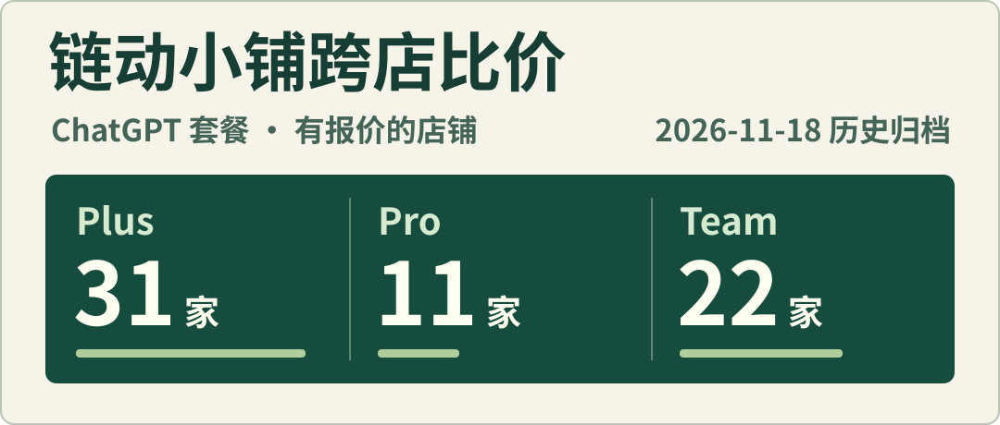
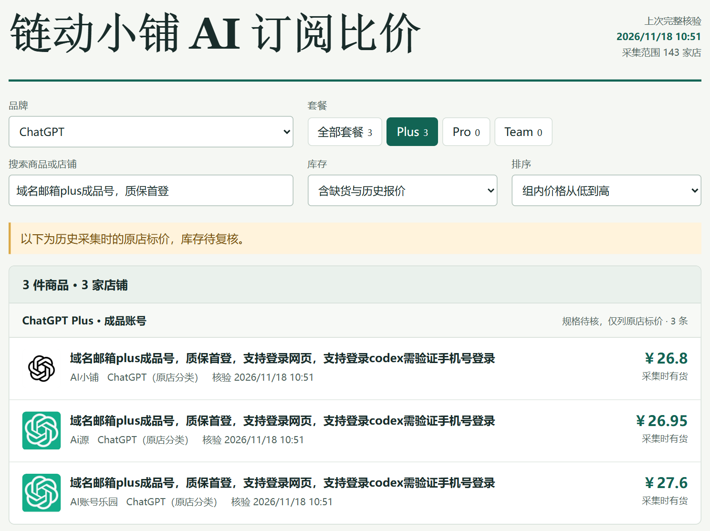

<div align="center">

<h1>链动小铺 AI 订阅比价</h1>



<p><strong>下次买 ChatGPT Plus、Pro 或 Team，先把链动小铺多家商户的同规格报价从低到高排一遍，看看便宜的那家还有没有货。</strong></p>

<p><strong><a href="https://zhangshixing0.github.io/team-price-monitor/">打开比价页</a></strong> · <a href="https://zhangshixing0.github.io/team-price-monitor/?brand=chatgpt&amp;plan=team">只看 Team</a> · <a href="docs/chatgpt-plans.md">查看历史统计</a> · <a href="docs/operations.md">自建比价页</a></p>

<p><a href="package.json"></a> <a href="docs/operations.md"></a></p>

</div>

## 同规格排序解决什么问题？

在诚心优选、玄奇仙市等链动小铺店铺之间挑套餐，光搜「Team」会碰到 5×、10× 和期限不同的席位；只看「Plus」，又容易拿月付和年付比价格。这个工具把多家商户的公开报价放到一页，保留原店标题、库存和核验时间。选好套餐就能在同规格内按价排序，也可以点商品标题回原店核对。[查看试点店铺名单及原店入口](docs/shops.md)



**同一个标题，三家店各卖多少钱？** 2026 年 11 月 18 日，域名邮箱 Plus 成品号在 AI小铺标价 **¥26.80**，Ai源 **¥26.95**，AI账号乐园 **¥27.60**。三家采集时均有货，支持单件购买。三份商品说明也相同，都写明可登录网页，质保范围是下单后一小时内的首次登录，订阅时长未注明。

**同样是带账单、保订阅 30 天的 Plus 成品号，五家店相差 ¥28。** 同一天，五家店都在卖「【质保30天】OpenAI plus 官充成品号 带账单」。五份商品说明逐字相同，都把下单后 30 天内订阅中途失效写进质保范围。采集时五家店均显示有货，都可以只买一件。

| 链动小铺商户 | 11 月 18 日标价 |
| --- | ---: |
| 杨洋的Ai小店一号 | ¥77.00 |
| AI账号乐园 | ¥79.35 |
| 52XUEAI | ¥93.00 |
| AI 速达数字店 | ¥105.00 |
| 远程技术服务站【诚招代理】 | ¥105.00 |

[打开五家店的这组报价，逐条查看原店商品](https://zhangshixing0.github.io/team-price-monitor/?plan=plus&q=%E5%AE%98%E5%85%85%E6%88%90%E5%93%81%E5%8F%B7%20%E5%B8%A6%E8%B4%A6%E5%8D%95)

如果你要买**明确写着月卡的成品号**，AI账号乐园当时有一件标价 **¥34.50**，商品说明只保下单后半小时内首登。如果想**给自己的账号充值**，煎饼果子Oliver 当时有一条菲律宾区 Plus 代充标价 **¥73.80**，标题写明带账单、质保一个月。[¥34.50 成品号月卡](https://wzyp.cn/item/2qtl1f) · [¥73.80 菲律宾区代充](https://wzyp.cn/item/iqidc2)

## 快速开始

1. 在手机或电脑上[打开比价页](https://zhangshixing0.github.io/team-price-monitor/)，选 **Plus、Pro 或 Team**。首版展示 2026 年 11 月 18 日的历史报价，页面列出核验时间。
2. 用商品名或店名缩小范围，按组内价格排序。对照交付方式、期限和质保条件，点商品标题可回原店核对现在的价格与库存。
3. 把筛好的页面加入浏览器书签，下次可直接回到同一组筛选。例如可以直接[收藏 ChatGPT Team](https://zhangshixing0.github.io/team-price-monitor/?brand=chatgpt&plan=team)。有可核对的前后两轮报价时，可筛出本轮补货或同规格降价。

也可以从[试点店铺目录](docs/shops.md)直接进入原店。想自己更新报价，可按[自建指南](docs/operations.md)运行采集；想断网试操作，可下载[单文件演示](docs/demo.html)，里面的 3 家店和 8 件商品是虚构样例。

## 历史样本覆盖了哪些店

本地候选库收录 **535 个不同的链动小铺店铺入口**。其中 171 家曾出现 Team 线索。2026 年 11 月 18 日的一轮定向采集读到了 **143 家店的 259 个目标分类**，并未逐店普查 535 家的全部商品。默认自建配置选用其中 20 家试点店。

这一轮的 4,562 件原始商品中，离线回放初步归类了 437 件。公开页剔除了 3 件提取支付链接的工具或教程、4 件第三方 API 额度商品，另有 2 件 Team 的商品图出现 K12 或 Claude 标记，暂列待核。公开页展示 **42 家店的 428 条历史报价**，其中 257 条在核验时有货。同一家店可以卖多个套餐。

| 套餐 | 商品 | 店铺 | 核验当时有货 |
| --- | ---: | ---: | ---: |
| Plus | 196 件 | 31 家 | 119 件 |
| Pro | 31 件 | 11 家 | 29 件 |
| Team | 201 件 | 22 家 | 109 件 |

单看 Team，这一轮还有 **125 家店的 1,451 件 Team 候选**缺少一致的品牌证据，其中 12 家也有已归类的 ChatGPT Team 商品。完整离线回放可在「品牌待核」查看这些候选。公开页仅收录已归入 ChatGPT 的报价。Plus 和 Pro 的数量同样只反映本轮查过的目标分类。以上 437 件初步归类商品都还有规格条件待核对。[统计口径与离线回放方法](docs/chatgpt-plans.md)

更早的 PickAI 归档记录过更广的 Plus、Pro 覆盖。2026 年 8 月 5 日按其原站分类和显示名去重，Plus（含代充）有 **277 个店名**，Pro 有 **208 个**，Team/Business 有 **18 个**。这些是当时出现过的店名。[PickAI 历史样本及另外两批数据的差别](docs/chatgpt-plans.md)

下次续费前还想找回这份店铺目录，可以点仓库右上角的 **Star** 收藏。发现漏收的链动小铺商家，或看到月卡被分进年卡，欢迎附上公开店铺链接和商品标题。[反馈店铺或分类问题](https://github.com/ZhangShixing0/team-price-monitor/issues)

## 自建与验证

在项目目录安装依赖，完成首轮采集后启动本地页面。需要 **Node.js 22.13+**；Windows 默认使用已安装的 Edge，Linux 的浏览器安装步骤见[自建指南](docs/operations.md)。

```sh
npm ci
npm run hourly
npm run preview
```

在同一台电脑打开[本地比价页](http://127.0.0.1:8768/)。默认配置核验 20 家试点店的已知分类。维护端可按小时运行，访客搜索和排序直接读取已经发布的报价。遇到原店验证或分页未读全时，已有网站继续显示上次完整报价及其核验时间。

本地运行 `npm test` 可以用固定样本检查套餐分类、排序和采集失败后的报价保留。[20 店采集实测](docs/pilot.md)

### 公开部署与数据安全

访客只需读取报价文件。部署时把写入凭据留在采集端，通过环境变量配置；网站对外提供只读页面。[定时运行与故障处理](docs/operations.md) · [云端发布配置](hosting/README.md)
